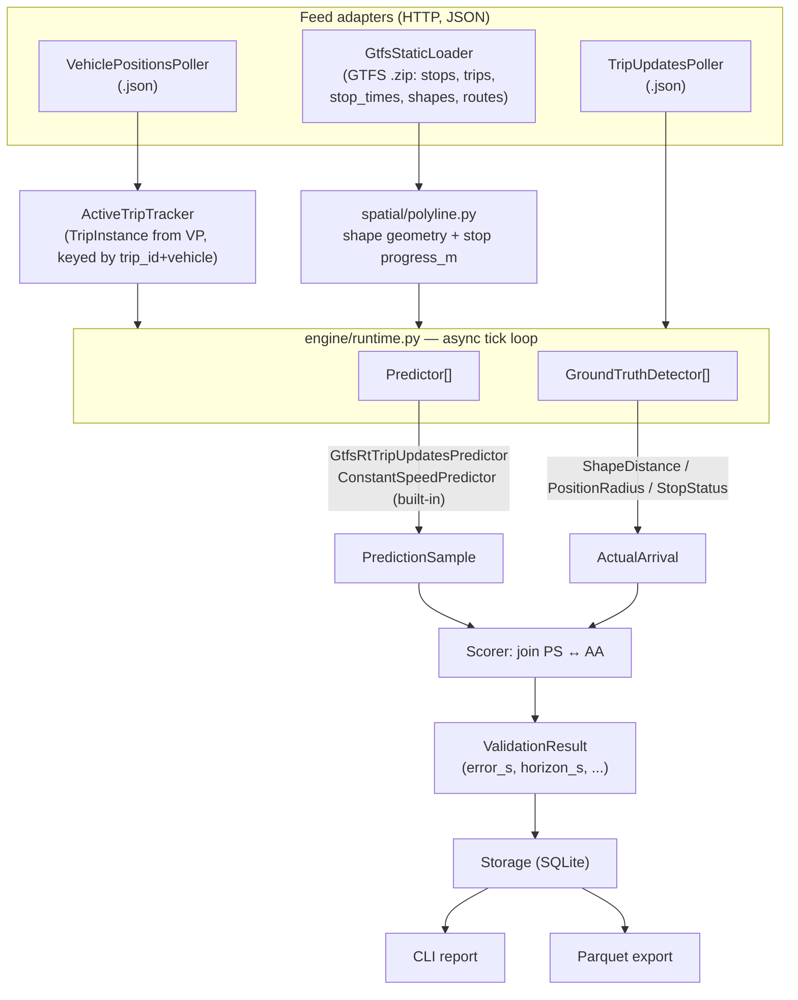

# Plan — ETA Prediction Validation Tool (`etaval`)

> **Status note:** This document records the plan and decisions as locked for the
> original P0–P6 headless-slice PR. P7 (FastAPI REST + WebSocket API) and P8 (Nuxt web
> UI), described below as "deferred" / "a follow-up," have since landed — see the
> top-level `README.md` "Status" section for what exists today (API, web UI, and a
> Textual TUI). The rest of this file is kept as the historical record of that PR's
> scope and reasoning.

## Context

We can produce GTFS-RT trip-update ETAs, but we have **no way to measure how good
any ETA prediction is**. `etaval` is a **brand-new, fully standalone tool** that,
for a live trip, collects the arrival predictions published throughout the trip,
independently detects when the vehicle actually reaches each stop, and scores the
predictions against that ground truth — with emphasis on **how error evolves with
prediction horizon** (were early predictions worse than late ones? does the
prediction converge to the truth as the bus approaches?).

**Decisions locked by the user (this session):**
1. **Pristine standalone project in a blank folder.** databus is *not* a code
   dependency and is *not* imported or ported from. The tool reads only **published
   GTFS-RT JSON feeds**, exactly as any agency serves them.
2. **databus = one agency (bUCR), configured like any other.** Ship two sources out
   of the box: **MBTA** and **bUCR** (databus dev stack). Adding an agency = adding a
   YAML source config, nothing else.
3. **This PR delivers the headless vertical slice (P0–P6):** domain + storage + feed
   adapters + spatial + predictors + ground-truth + scoring + engine + Typer CLI,
   with tests and captured feed fixtures. The FastAPI/WebSocket API and Nuxt/MapLibre
   UI (P7–P8) are a deliberate follow-up.

**What the codebase exploration changed vs. the original draft:**
- We are *inside* databus; there is no `../git/databus`. Per the user, none of it is a
  dependency. The "reuse `gtfs_eta` / port `geo.py`/`shapes.py`" items are **dropped** —
  etaval implements its own (standard) spatial math and its own baseline model.
- `docs/navsat-mqtt-bridge.md` **does not exist**. The "training-corpus synergy" and
  the Hive/S3 export layout that cited §5/§6 are **descoped** to a deferred note;
  Parquet export stays, but no nonexistent layout is referenced.
- VehicleStopStatus (`current_status=STOPPED_AT`, `current_stop_sequence`, `stop_id`) is
  a **standard GTFS-RT VehiclePositions field** (confirmed in databus
  `schedule_engine/builders.py:119`; MBTA populates it too). So the "stop-status
  cross-check" detector is a **generic GTFS-RT detector**, not a databus-specific one.
- Feeds are consumed as **JSON** (user's explicit choice) → **no protobuf dependency**.
  GTFS-RT JSON entity shapes were confirmed against `builders.py` and the GTFS-RT spec.

## Architecture

Three pluggable seams are the design; everything else is plumbing.



Data flow per tick: poll feeds → update active `TripInstance`s and their position
history → for each active trip, ask every `Predictor` for ETAs to upcoming stops
(one `PredictionSample` per predictor×stop×tick) → run every `GroundTruthDetector`
(fires `ActualArrival` when a stop is reached) → `Scorer` joins samples to actuals
and emits `ValidationResult`s → persist all three.

## Domain model (`etaval/domain/models.py`, Pydantic v2)

- `SourceConfig` — `name`, `gtfs_static_url`, `vehicle_positions_url`,
  `trip_updates_url`, `poll_interval_s`, optional `headers`/`auth`, detector params
  (`arrival_radius_m`, `dwell_s`, `shape_threshold_m`). Loaded from YAML.
- `TripInstance` — `(source, trip_id, vehicle_id, route_id, direction_id, shape_id,
  start_date, started_at)`. The unit of validation; identified from VehiclePositions.
- `Stop` — `(stop_id, stop_sequence, lat, lon, progress_m)`.
- `VehicleState` / position history per `TripInstance` — `(epoch, lat, lon, progress_m,
  speed, current_status, current_stop_sequence)`.
- `PredictionSample` — `(trip_key, predictor_id, stop_id, stop_sequence,
  predicted_arrival_epoch, made_at_epoch, vehicle_progress_m_at_made, dist_remaining_m,
  stops_remaining)`.
- `ActualArrival` — `(trip_key, stop_id, stop_sequence, actual_arrival_epoch, method)`.
- `ValidationResult` — derived once actual is known: `error_s = predicted - actual`,
  `horizon_s = actual - made_at` (lead time), plus `dist_remaining_m`, `stops_remaining`,
  `predictor_id`, `route_id`.

## Pluggable interfaces (`etaval/domain/interfaces.py`, Protocols)

- `Predictor.predict(trip, upcoming_stops, vehicle_state, trip_updates) -> list[StopPrediction]`
- `GroundTruthDetector.detect(trip, position_history, stops) -> list[ActualArrival]`
- `FeedAdapter.poll() -> parsed entities` (one JSON GTFS-RT impl, one GTFS static impl)
- `Storage` — `save_samples / save_arrivals / save_results / load_results`

## Repo layout (blank standalone folder `etaval/`)

```
etaval/
  pyproject.toml                 # uv project, deps below; package name "etaval"
  README.md
  etaval/
    domain/      models.py, interfaces.py
    feeds/       gtfsrt_json.py   # VP + TU pollers (httpx, json)
                 static.py        # GTFS .zip loader (zipfile + pandas)
                 source_config.py # YAML → SourceConfig
                 tracker.py       # ActiveTripTracker
    spatial/     polyline.py      # haversine, cumulative polyline, point projection,
                                  # monotonic (loop-back-safe) stop assignment, upcoming-stop slice
    predictors/  base.py, gtfsrt_tripupdates.py, constant_speed.py
    groundtruth/ base.py, shape_distance.py, position_radius.py, stop_status.py
    scoring/     scorer.py, metrics.py
    storage/     base.py, sqlite.py, parquet_export.py
    engine/      runtime.py       # async tick loop wiring everything
    cli/         main.py          # Typer: run / report / sources
    config/      sources/mbta.yaml, sources/bucr.yaml
  tests/
    fixtures/    mbta_vp.json, mbta_tu.json, bucr_vp.json, bucr_tu.json, mini_gtfs.zip
    test_spatial.py, test_predictors.py, test_groundtruth.py,
    test_scoring.py, test_feeds.py, test_engine_replay.py, test_cli.py
```

## Build phases (P0–P6, in order)

**P0 — Foundation.** `domain/models.py`, `domain/interfaces.py`, `storage/base.py` +
`storage/sqlite.py` (three tables: prediction_samples, actual_arrivals,
validation_results; indexed by trip_key+predictor_id), `feeds/source_config.py`, and
the two YAML sources. *Verify:* round-trip a `SourceConfig` from YAML; insert/read each
table.

**P1 — Feed adapters.** `feeds/gtfsrt_json.py`: async `httpx` GET of VP and TU JSON,
parse the standard GTFS-RT FeedMessage (`header.timestamp`, `entity[]`). VP entity →
`VehicleState` (`vehicle.position.{latitude,longitude,bearing,speed}`,
`vehicle.timestamp`, `vehicle.current_status/current_stop_sequence/stop_id`,
`vehicle.trip.{trip_id,route_id,direction_id}`). TU entity →
`stop_time_update[].{stop_sequence, stop_id, arrival.time}`. `feeds/static.py`: load the
GTFS `.zip` with `zipfile`+`pandas`, expose `stops`, `trips`, `stop_times`, `shapes`,
`routes`; provide `trip_geometry(trip_id) -> (shape points, ordered stops)`.
`feeds/tracker.py`: maintain `TripInstance`s keyed by `(trip_id, vehicle_id)`, append
position history, expire stale trips. *Verify:* parse captured fixtures → expected
entity counts/fields; tracker creates/updates/expires instances on a scripted sequence.

**P2 — Spatial.** `spatial/polyline.py` (standard map-matching, implemented fresh, no
external geometry dep): `haversine_m`; `build_polyline(shape_pts, shape_dist_traveled?)`
→ cumulative `(lat,lon,cum_m)`; `project_point_to_polyline(lat,lon,polyline)` →
`{progress_m, cross_track_m, segment_idx}`; `assign_stops_monotonic(stops, polyline)` —
DP/Viterbi forward-monotonic projection so loop-back/doubling-back shapes don't snap a
late stop to an early segment; `upcoming_stops(progress_m, stops)` slice. Build per-trip
geometry from the static loader once and cache by `(source, shape_id, trip_id)`.
*Verify:* straight-line and looped synthetic shapes → monotonic non-decreasing stop
`progress_m`; projection cross-track within tolerance.

**P3 — Predictors.** `predictors/base.py` (Protocol + `StopPrediction`).
`gtfsrt_tripupdates.py` (`predictor_id="gtfsrt"`): for the active trip's matching TU
entity, emit one prediction per upcoming stop using `arrival.time`, `made_at` =
feed `header.timestamp`. `constant_speed.py` (`predictor_id="baseline:constant_speed"`,
etaval's **own built-in white-box model**, zero external deps): speed = Δprogress_m/Δt
from position history (fallback to reported `speed`); predicted arrival = now +
`dist_remaining_m / speed` per upcoming stop. Two predictors → real head-to-head
comparison and horizon curves with no agency model required. The Protocol stays open so
users can register additional in-process models later. *Verify:* synthetic vehicle_state
+ TU fixture → expected per-stop predictions and `made_at`.

**P4 — Ground truth.** `groundtruth/shape_distance.py` (**default**): arrival fires when
the vehicle's monotonic `progress_m` reaches a stop's `progress_m` (within
`shape_threshold_m`, at closest approach); loop-back safe via monotonic progress.
`position_radius.py`: within `arrival_radius_m` (optional `dwell_s`).
`stop_status.py` (generic cross-check): arrival when VP `current_status==STOPPED_AT`
with matching `current_stop_sequence` — standard GTFS-RT, works for MBTA and bUCR.
Each yields `ActualArrival(method=...)`. *Verify:* scripted position track crossing
known stops → each detector fires the expected arrivals at the expected times.

**P5 — Scoring + engine.** `scoring/scorer.py`: join `PredictionSample` ↔
`ActualArrival` on `(trip_key, stop_id)` → `ValidationResult`. `scoring/metrics.py`
(pandas): per-predictor MAE/RMSE/MAPE/bias; **error-vs-horizon curve** (bucket by
horizon: >10m, 5–10m, 2–5m, <2m → MAE/bias per bucket); **convergence** per (trip,stop)
prediction series (monotonic convergence, overshoot/oscillation, settling time);
aggregates sliced by horizon, stop position, route, time-of-day; head-to-head win-rate.
`engine/runtime.py`: `asyncio` loop — every `poll_interval_s`, poll VP+TU, update tracker
+ geometry, run all predictors and detectors for each active trip, run the scorer for
newly-resolved stops, persist samples/arrivals/results; runs for a fixed `--duration`.
*Verify:* feed captured fixtures through the engine in replay mode → non-empty samples,
arrivals fire, results populate with sane horizon curves.

**P6 — CLI.** `cli/main.py` (Typer): `etaval sources` (list configured),
`etaval run --source <name> [--route R] [--predictor gtfsrt --predictor
baseline:constant_speed] --duration 30m --out r.parquet` (drives `runtime.py` headless
across all matching active trips, persists to SQLite, exports Parquet via
`parquet_export.py`), `etaval report r.parquet` (prints per-predictor MAE + horizon
breakdown + model comparison via `rich`). *Verify:* CLI E2E below.

## Configured sources (shipped)

- **`config/sources/mbta.yaml`** — `vehicle_positions_url: https://cdn.mbta.com/realtime/VehiclePositions.json`,
  `trip_updates_url: https://cdn.mbta.com/realtime/TripUpdates.json`,
  `gtfs_static_url: https://cdn.mbta.com/MBTA_GTFS.zip`, `poll_interval_s: 15`.
- **`config/sources/bucr.yaml`** — base URL configurable (default `http://localhost:8000`):
  `…/feed/realtime/vehicle_positions.json`, `…/feed/realtime/trip_updates.json`,
  `…/feed/schedule/feed.zip`, `poll_interval_s: 5`.

## Dependencies (lean, standalone)

`httpx` (async polling), `pydantic` v2 (domain), `pandas` + `pyarrow` (analytics +
Parquet), `typer` (+`rich`) (CLI), `pyyaml` (sources). Static GTFS via stdlib `zipfile`
+ pandas (no `partridge`/`gtfs_kit`). **No protobuf, no databus, no `gtfs_eta`.**
Dev: `pytest`, `respx` (mock httpx).

## Verification

- **Unit:** scoring math on synthetic samples (known errors → known MAE/horizon buckets);
  detectors on a scripted position track; spatial monotonic projection on straight +
  looped shapes; JSON GTFS-RT parsing on captured fixtures.
- **Replay (offline, no network):** capture `.json` snapshots from the live MBTA feeds
  (and a hand-built bUCR fixture matching the confirmed shape) into `tests/fixtures/`;
  `test_engine_replay.py` runs the engine over them and asserts samples + arrivals +
  results populate.
- **CLI E2E (live, MBTA — network permitting):** `etaval run --source mbta --duration 10m
  --out r.parquet` then `etaval report r.parquet` → non-empty per-predictor MAE + horizon
  breakdown. If the bUCR dev stack is up, repeat with `--source bucr`.
- Capture the fixtures **first** so all tests run without a live stack.

## Deferred (explicitly out of scope for this PR)

- **P7 API / P8 UI** — FastAPI REST + WebSocket over the same `engine/runtime.py`, then
  Nuxt 4 + `@nuxt/ui` UI. Note: the existing databus frontend uses **`@unovis/vue` for
  charts and has no map library** — if/when we mirror that stack, charts = `@unovis`,
  and MapLibre would be a *new* dependency (the draft's "matches stack" for MapLibre/
  uPlot/ECharts was inaccurate).
- **Schedule baseline predictor** and **user-supplied in-process models** — drop into the
  open `Predictor` Protocol later.
- **S3 training-corpus export** — the draft cited `docs/navsat-mqtt-bridge.md` §5/§6,
  which does not exist; revisit only if/when that layout is actually defined.
```
